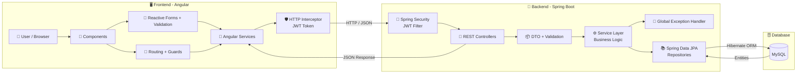
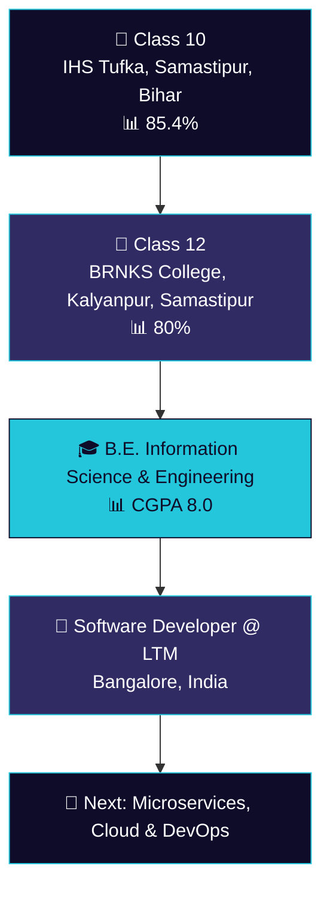

<!-- ===================== ANIMATED HEADER ===================== -->

  

<!-- ===================== BADGES ===================== -->

  
  
  

  
  

---

<!-- ===================== ABOUT ME (ANIMATED) ===================== -->

  

<table align="center">
<tr>
<td>

👋 Hi, I'm **Siddharth Kumar Jha**, a **Software Developer at LTM** based in **Bangalore, India** 🇮🇳

- 💼 Working full-time as a **Software Developer** at **LTM**
- ☕ I specialise in **Java Full Stack Development**: Java • Spring Boot • Angular • MySQL
- 🔥 I build **REST APIs**, responsive frontends and database-driven web applications
- ⚙️ Hands-on with **CRUD, Pagination, Soft Delete, Validation, Routing & Authentication UI**
- 🛠️ Familiar with **ITSM**: Incident Management, SLA, RCA
- 🌱 Currently exploring **Microservices, Spring Security, JWT, Docker & CI/CD**
- 🎓 B.E. in **Information Science & Engineering**
- 📫 Reach me at **siddharthjha140804@gmail.com**

</td>
</tr>
</table>

---

## ⚡ Tech Stack

  
    
  

  
  
  
  
  
  

---

## 🏗️ How I Build Full Stack Applications

  
  
  
  
  

---

## 🚀 Featured Projects

<table align="center">
  <tr>
    <td width="50%" valign="top">
      <h3>🌱 <a href="https://github.com/sidjha0000/EcoGenius">EcoGenius</a></h3>
      Smart eco-focused application built to promote sustainable, environment-friendly choices.
        
      
    </td>
    <td width="50%" valign="top">
      <h3>🏠 <a href="https://github.com/sidjha0000/Awash360">Awash 360</a></h3>
      All-in-one web platform project.
        
      
    </td>
  </tr>
  <tr>
    <td width="50%" valign="top">
      <h3>🎮 <a href="https://github.com/sidjha0000/GameZone">GameZone</a></h3>
      Interactive browser games collection.
        
      
    </td>
    <td width="50%" valign="top">
      <h3>🧠 <a href="https://github.com/sidjha0000/MindSprint">MindSprint</a></h3>
      Interactive web project built with HTML.
        
      
    </td>
  </tr>
  <tr>
    <td colspan="2" align="center" valign="top">
      <h3>❓ <a href="https://github.com/sidjha0000/Quiz-Application">Quiz Application</a></h3>
      Quiz app with questions, scoring and instant results.
        
      
    </td>
  </tr>
</table>

---

## 🛤️ My Journey

---

## 🤝 Connect With Me

  
  
  

<!-- ===================== ANIMATED FOOTER ===================== -->

  

