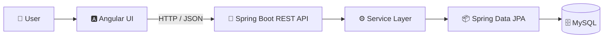

<!-- ===================== ANIMATED HEADER ===================== -->
<p align="center">
  
</p>

<!-- ===================== ANIMATED TAGLINE ===================== -->
<p align="center">
  
</p>

<!-- ===================== BADGES ===================== -->
<p align="center">
  
  
  
</p>

<p align="center">
  
  
</p>

---

## 👨‍💻 About Me

```java
public class Siddharth {

    String name       = "Siddharth Kumar Jha";
    String role       = "Graduate Apprentice @ LTIMindtree";
    String focus      = "Java Full Stack Development";

    String[] backend  = {"Java", "Spring Boot", "Spring Data JPA", "REST APIs"};
    String[] frontend = {"Angular", "TypeScript", "HTML", "CSS", "Bootstrap"};
    String[] database = {"MySQL"};
    String[] learning = {"Microservices", "Spring Security", "JWT", "Docker", "CI/CD"};

    String fuel       = "Chai ☕";

    public String motto() {
        return "Code. Debug. Learn. Repeat. 🚀";
    }
}
```

- 🏢 Currently working as **Graduate Apprentice @ LTIMindtree**
- 🔥 I build **REST APIs**, responsive frontends and database-driven web apps
- ⚙️ Hands-on with **CRUD, Pagination, Soft Delete, Form Validation & Routing**
- 🛠️ Familiar with **ITSM concepts**: Incident Management, SLA, RCA
- 📫 Reach me at **siddharthjha140804@gmail.com**

---

## ⚡ Tech Stack

<p align="center">
  
  <br/><br/>
  
</p>

<p align="center">
  
  
  
  
  
  
</p>

---

## 🏗️ How I Build Full Stack Apps



---

## 🚀 Featured Projects

<table align="center">
  <tr>
    <td width="50%" valign="top">
      <h3>🗳️ <a href="https://github.com/sidjha0000/Online-Voting">Online Voting</a></h3>
      Voting app where users cast votes, view real-time results and manage elections securely.
      <br/><br/>
      
      
    </td>
    <td width="50%" valign="top">
      <h3>📋 <a href="https://github.com/sidjha0000/Attendance-System">Attendance System</a></h3>
      Faculty attendance system to mark attendance, generate reports and download records.
      <br/><br/>
      
      
    </td>
  </tr>
  <tr>
    <td width="50%" valign="top">
      <h3>🧠 <a href="https://github.com/sidjha0000/MindSprint">MindSprint</a></h3>
      Interactive web project built with HTML.
      <br/><br/>
      
      
    </td>
    <td width="50%" valign="top">
      <h3>🧮 <a href="https://github.com/sidjha0000/simple-calculator-">Simple Calculator</a></h3>
      Calculator with memory that lets users recall previous results.
      <br/><br/>
      
      
    </td>
  </tr>
</table>

---

## 🛤️ My Journey

<details>
<summary><b>👉 Click to expand</b></summary>
<br/>

| Stage | Milestone |
|:--|:--|
| 🎓 | Built web projects with PHP, HTML, CSS & MySQL |
| ☕ | Learned Java, Spring Boot & Angular through Java Full Stack training |
| 🏢 | Joined **LTIMindtree** as Graduate Apprentice |
| 🛠️ | Explored ITSM: Incident Management, SLA & RCA |
| 🚀 | Next: Microservices, Spring Security, Docker & CI/CD |

</details>

---

## 🤝 Connect With Me

<p align="center">
  <a href="https://www.linkedin.com/in/siddharth-kumar-jha-746a6227b" target="_blank">
    
  </a>
  <a href="mailto:siddharthjha140804@gmail.com">
    
  </a>
  <a href="https://github.com/sidjha0000">
    
  </a>
</p>

<p align="center"><b>⭐ Thanks for visiting! Let's build something amazing together 🚀</b></p>

<!-- ===================== ANIMATED FOOTER ===================== -->
<p align="center">
  
</p>
